# 小弓宝 ArchPal · 大动脉炎（TAK）工作台

本机优先的大动脉炎（Takayasu Arteritis）确诊档案与随访资料整理工作台：受累血管节段记录、炎症指标（ESR/CRP）趋势、四肢血压成对对比、激素与免疫抑制剂剂量记录、影像随访与复诊准备。

> 品牌名「小弓宝 / ArchPal」为占位，待晨审追认。
> **诚实声明：0 患者访谈、0 临床审核。** 全部场景为假设、全部演示数据为合成示例；医学口径已对照国家卫健委《86 个罕见病病种诊疗指南（2025 年版）》第 76 节原件核数（见 docs/CLINICAL-DATA.md 台账），阈值仍为【待核】占位。本工作台只做信息整理与就诊准备，不做诊断、不判活动度、不选治疗。

## 疾病概要

大动脉炎（TAK）工作台的疾病概要分四段（与原型顶栏「?」整页同源），每段带来源行：

### 定义

累及主动脉及其一级分支的慢性肉芽肿性大血管炎，可引起管壁增厚、管腔狭窄或闭塞、动脉瘤形成；在中国列入国家罕见病指南管理（2025 年版第 76 节，PDF 页 454–461，原件已取得）。人群特征（指南引用的上海调查）：男女比约 1∶4，多在青年期发病，90% 在 30 岁前发病。

### 医学资料规范和指南情况

国家卫健委《86 个罕见病病种诊疗指南（2025 年版）》第 76 节（原件已取得，第三方镜像）；《中国大动脉炎诊疗指南(2023)》（中华内科杂志 2024，解读原件已取得）；《中国大动脉炎相关高血压诊治多学科专家共识》（复旦学报 2021，官方期刊页面）。「未取得原件」的条目不作为依据引用；阈值一律【待核】。

### 目前治疗全景概要

按类别只列公开事实：糖皮质激素（诱导缓解基础类别，指南写明缓解后渐减路径）；传统合成免疫抑制剂（环磷酰胺/硫唑嘌呤/甲氨蝶呤/来氟米特/吗替麦考酚酯/钙调磷酸酶抑制剂等类别）；生物制剂（托珠单抗在日本获批 TAK、中国说明书 2025-02 版原件核对未列入，属说明书外使用）；血管介入/手术（专科决策）；随访监测三件套（化验+四肢血压/ABI+影像）。**不代表任何一项适合你，需要问你的医生。**

### 发展趋势

只写已发生事实并带日期：2025-07 国家指南收载第 76 节；2024-02《中国大动脉炎诊疗指南(2023)》发表；2026-11-05 ClinicalTrials.gov API 实查 78 项注册/27 活跃/中国站点 25；2017-08 托珠单抗日本获批；2026-11-05 本工作台建立 v0.2.0 原型。

## 关键功能（截图墙 · v0.2.0 原型实渲）

### 看板：确诊、血管、指标、血压、用药放在一页
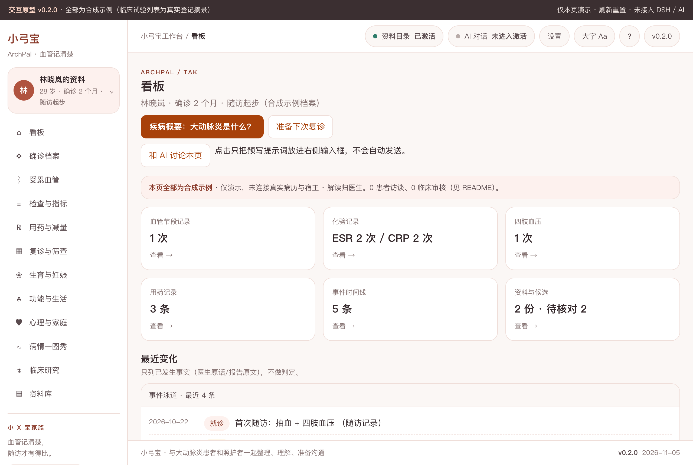
刚确诊的患者一进来就能看到「该看什么、缺什么」；全部数字来自同一份合成示例数据，标注"仅演示，未连接真实病历与宿主"。

### 检查与指标：194px 定高 3D 翻转卡
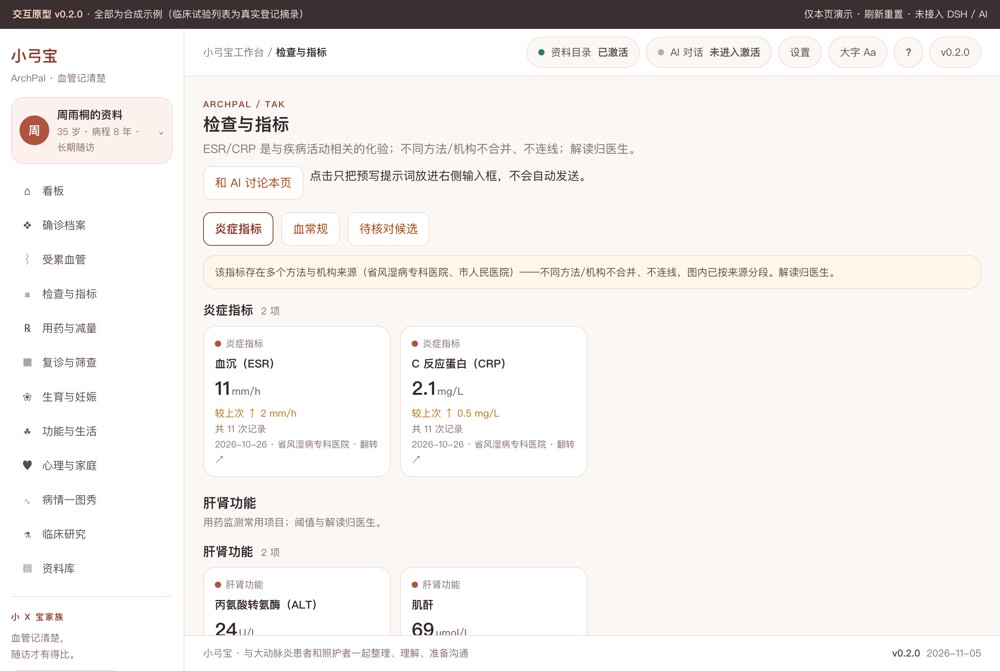
正面是最近值/较上次差值/次数/来源（差值只写「较上次」，不暗示好坏）；不同方法/机构来源时同屏提示「不合并、不连线、解读归医生」。
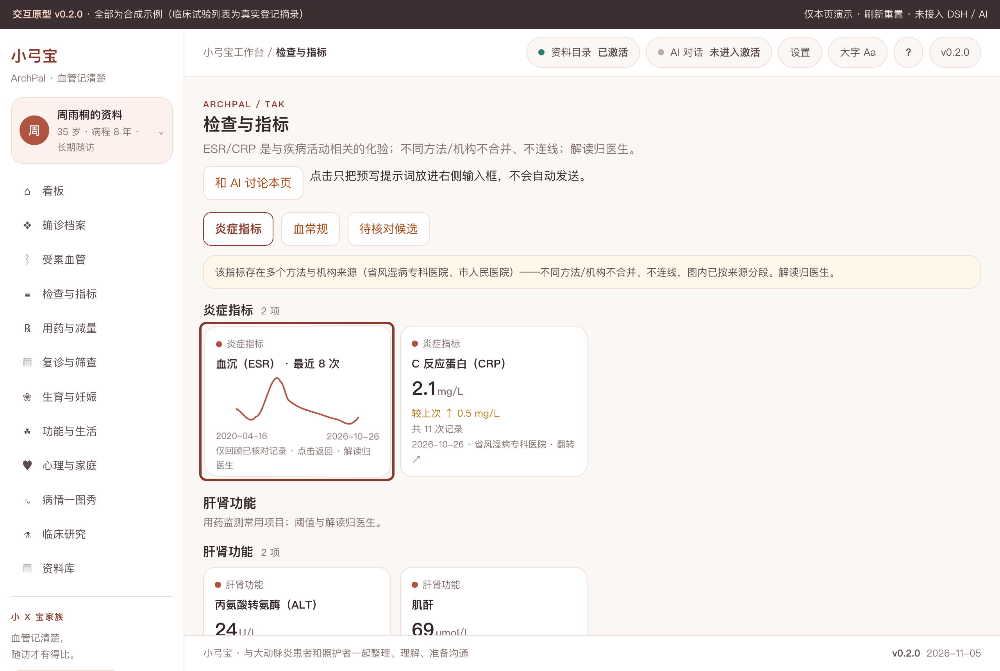
背面是最近 8 次折线与时间范围；单点序列不连线，只有 1 次记录会明说。

### 受累血管图谱：报告原文按节段留版本
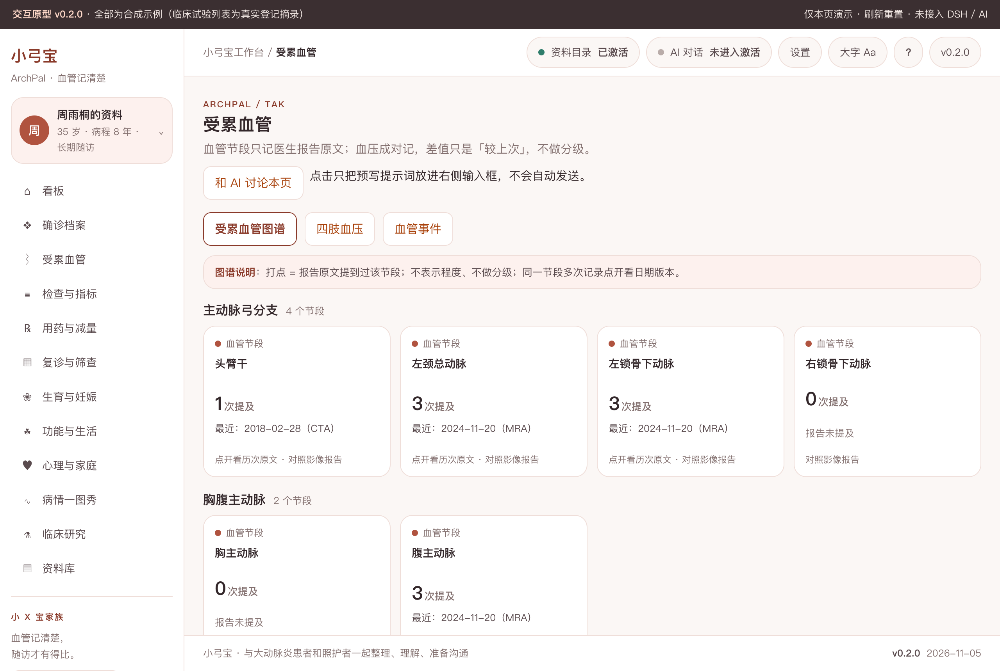
打点 = 报告原文提到过该节段；不表示程度、不做分级；同一节段多次记录翻卡可看历次原文。
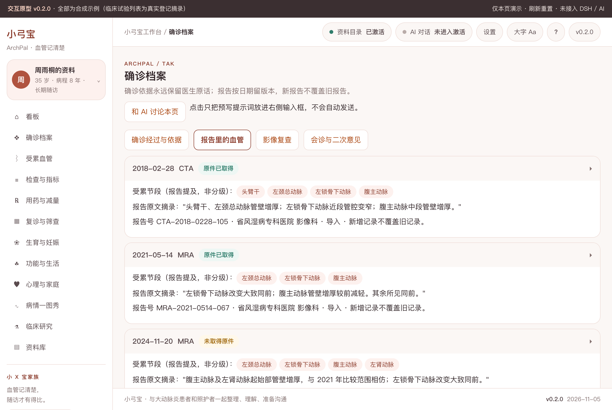
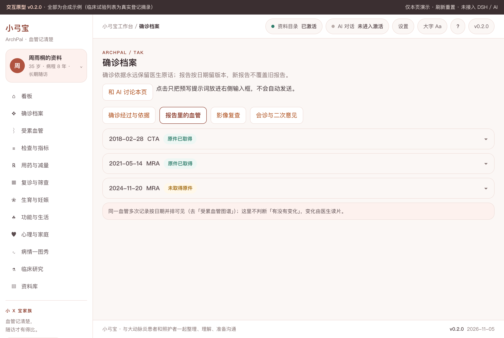
按一次影像报告折叠（原生 details，可打印全展开），新报告不覆盖旧记录。

### 四肢血压成对记录
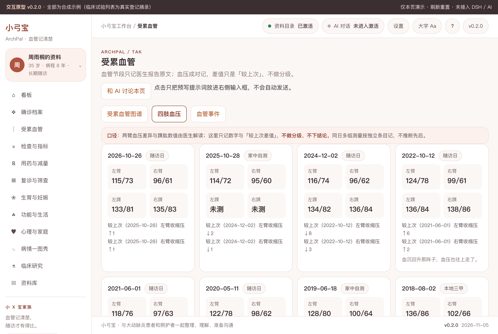
左臂/右臂/双踝成对录入，自动显示「较上次差值」；部位不全时如实写「未计算差值」，不做分级。

### 病情一图秀
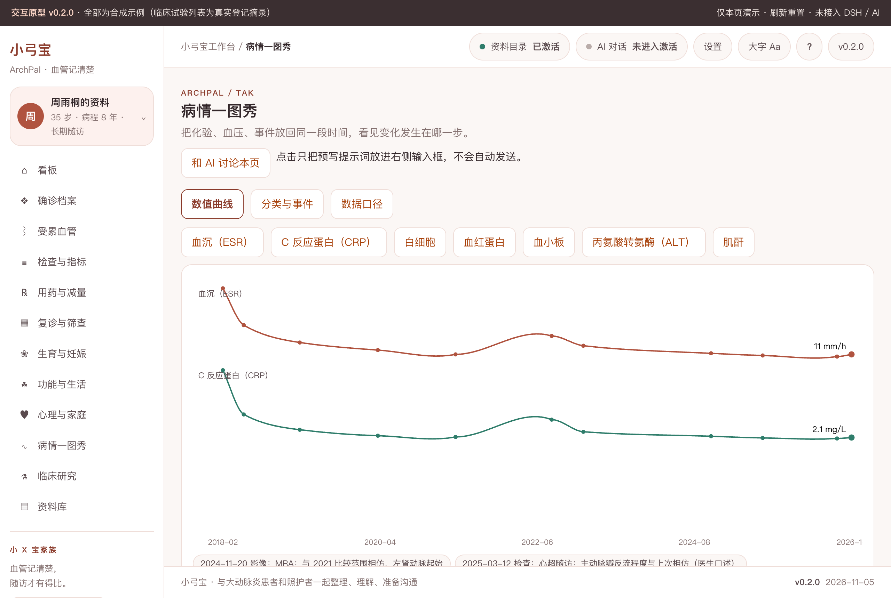
每条线按该指标全期 min/max 归一化并标注「不可比」；单点不连线；事件条与曲线分层展示；数据点可点开看原始来源。

### 用药与减量阶梯
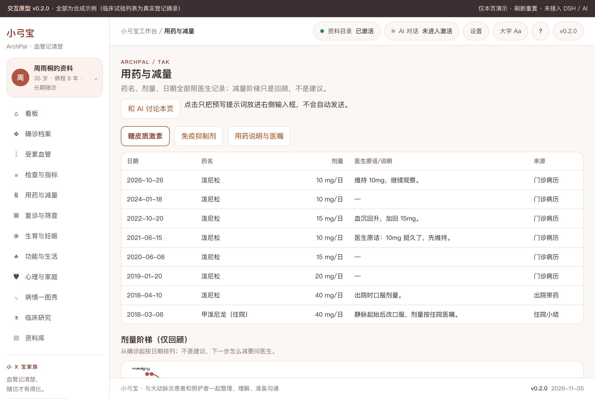
激素剂量按日期排成阶梯（仅回顾，不是建议）；医生原话单独留痕在「用药说明与医嘱」。

### 疾病概要整页（顶栏 ?）
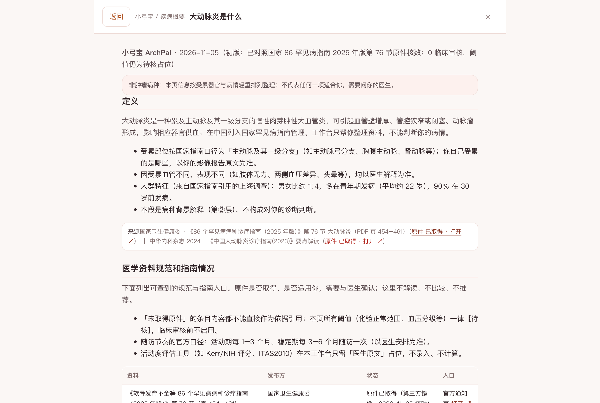
四段固定：定义 → 医学资料规范和指南情况 → 治疗全景 → 发展趋势；每段强制来源行；趋势段只写已发生事实并带日期。

### AI 草稿（未接入，只填不发）
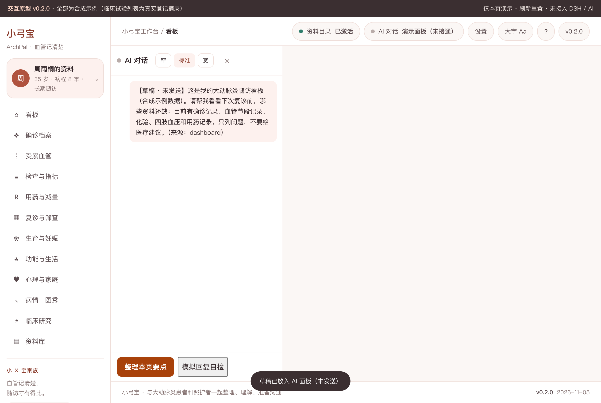
每页「和 AI 讨论」只把预写提示词放进右侧面板，标明「未接通任何模型，不会发送」；私密条目不进 AI 上下文。

## 怎么用

1. 打开 `prototypes/v0.2/index.html`（file:// 双击即可，或 `python3 -m http.server` 后访问）。
2. 点左上角头像切换 A（刚确诊记录少）/ B（多年随访记录多）两套合成档案——整页数据、图表、时间线、导出全部联动不串档。
3. 顶栏顺序：资料目录 → AI 对话 → 设置 → 大字 Aa → ?（疾病概要）→ 版本。
4. 「待核对候选」页演示导入 → 解析 → 候选 → 核对入库 / 拒收零副作用链路。
5. 开发版（接入 DSH Desktop 后）由宿主资料目录授权读取真实文件；原型不读写任何真实文件。

## 数据与口径

- **演示数据唯一源**：`prototypes/v0.2/demo-data.js`；改一个值，看板/卡片/图表/时间线/导出同步变。
- **私密三出口**：导出、AI 上下文、摘要预览共用同一过滤函数；页内显示「N 条中私密 M 条」。
- **无判读列**：schema 不入库 diagnosis/risk_level/activity_score 等派生判定；活动度评分只作「医生原文 + 待核」占位。
- **非肿瘤表达**：活动期—稳定期 + 受累血管节段 + 随访节律；无分期/线序/疗效/生存期语义。
- **来源分级**：A 原件（86 指南 PDF、托珠单抗 NMPA 说明书）已取得，见 `docs/CLINICAL-DATA.md`；B 官方目录/期刊页面；D 二手；未取得一律标注。

## 开发

```bash
npm run check          # 静态检查链（staticPass=true）
node scripts/probe-tak-m2.mjs        # M2 原型探针（32 条真实浏览器断言）
node scripts/probe-page-view.mjs     # 家族整页视图探针（starter 契约自检）
node scripts/probe-disease-primer.mjs --self-test  # 疾病概要探针
node scripts/shoot-prototype.mjs     # 重新生成 README 截图
```

- 结构基准：cervical-workbench（外壳/客户端链路底本）+ breast-cancer v0.4（指标卡/眉题）+ aml-workbench（AI 面板/泳道/折叠卡）；只抄结构与元素体系，不抄病种语义。一级导航重名率实测最高 50%（≤70%），见 docs/FAMILY-CONTRAST.md。
- 里程碑与闸口：docs/DEV-PLAN.md；进度：PROGRESS.md；签认：docs/signoffs/。
- 许可与品牌：品牌占位名待授权；数据合同冻结见 schema/freeze-contract.json。
